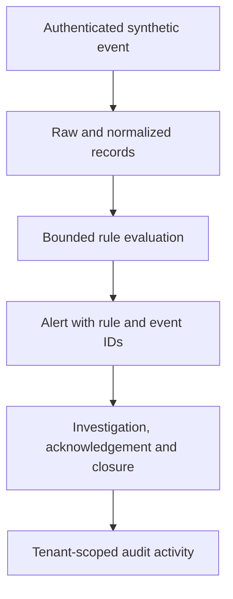

# Public Showcase Guide

Use this path when reviewing Helix Sentinel as a public portfolio project or engineering sample.

## Case study: from a synthetic event to a reviewable alert

**Problem.** An analyst needs to tell which observation caused an alert and what happened during review. Counting rule matches alone loses this relationship.

**Constraints.** The preview has one modular backend, synchronous bounded evaluation and a limited Sigma subset. The PostgreSQL identity adapter currently assigns accounts to the default tenant. The dataset contains one synthetic identity event.

**Architecture.** The authenticated ingestion route writes a raw record, then the normalizer writes a queryable event with its own ID. A rule execution links its match to that event. The alert repository enforces a unique rule/event pair. Acknowledgement and closure are separate, auditable actions.

**Engineering decision.** The event ID connects the ingest response, evaluator and alert. Explicit execution keeps the analysis bounded. The database uniqueness constraint protects repeated rule/event pairs. Permission and tenant checks occur before event persistence; the accepted record carries an actor ID and a correlation ID.

The activity aggregate groups by a named SQL result column for the JSON workflow state. Building the JSON path twice introduced two independent parameters that PostgreSQL could not equate during grouping. The database replay reads the actual aggregate and checks acknowledgement and closure counts.

**Replay.** The [PostgreSQL investigation test](../backend/tests/events/test_postgres_investigation.py) signs in a generated account, posts an event, imports one active rule, reads its alert, acknowledges it, closes it and retrieves the resulting audit activity. It checks that the same event ID appears at each link and that both workflow updates are visible. The **Correlate synthetic event, alert and audit records in PostgreSQL** CI step prints a compact JSON record with only synthetic identifiers, counts and observed states. It uses the production app factory and PostgreSQL adapters through an in-process HTTP transport.

To repeat the run, use a disposable PostgreSQL 16 database with the test connection settings in [conftest.py](../backend/tests/conftest.py), apply the [CI migration command](../.github/workflows/ci.yml), then run `HELIX_RUN_DATABASE_DEMO=1 pytest -q -s backend/tests/events/test_postgres_investigation.py`. The replay creates synthetic rows. Each run uses a unique event source and account.

**Limits and next step.** This replay exercises the API and database. Dashboard rendering, detection accuracy and load behavior require separate evidence. Raw event, normalized event and audit persistence have separate transaction boundaries; a mid-request failure can leave an incomplete sequence. Reconciliation or an atomic ingest transaction would need an explicit recovery contract. Production tenant membership and persistent session revocation also require design and migration work.

## Review Path

1. Read the repository overview in [README.md](../README.md), especially the at-a-glance summary and current security boundaries.
2. Open the architecture overview to confirm the modular-monolith boundaries and explicit non-goals.
3. Bind the frontend to loopback for single-user review and open the SOC dashboard. The dashboard uses the configured server-side account for reads and workflow updates.
4. Review the dashboard from top to bottom: executive posture, triage pressure, detection coverage, audit-backed security activity, priority findings, open alert queue, and selected-alert investigation detail.
5. Select an alert and follow the investigation panel through triage readiness, evidence pivots, context timeline, acknowledgement, and closure.
6. Follow the [event-to-evidence walkthrough](demo-data.md#event-to-evidence-walkthrough) for exact request bodies. The seeder alone only inserts events; account provisioning, an active rule, explicit rule execution, and authenticated dashboard access are separate prerequisites.
7. Run the publication validation gate in [release-readiness.md](release-readiness.md) before sharing the repository.

## What The Demo Should Show

- The product is an operational SOC workflow application, not a marketing page.
- Alerts are persisted lifecycle records with status, assignment, notes, disposition, and timestamps.
- Investigation context is bounded by source, category, and event time rather than an unbounded SIEM search language.
- Executive posture and dashboard KPIs are deterministic summaries over normalized events, alert workflow state, coverage analytics, threat analytics, AI-assisted analytics, and audit activity.
- API access from the frontend remains server-side, including bearer-token handling.

## Screenshot Targets

For public repository images or a portfolio walkthrough, capture:

- The full dashboard with executive posture and operational brief visible.
- The open alert queue with one selected alert.
- The investigation detail panel showing triage readiness, evidence pivots, and context timeline.
- The detection coverage and security activity panels.

## Demo Capture Checklist

- Use synthetic or sanitized seed data only.
- Keep demo data bounded to the `default` tenant and synthetic identifiers.
- Capture the dashboard after selecting an alert so the investigation panel is populated.
- Prefer a desktop-width viewport so executive posture, operational brief, alert queue, and investigation detail are visible together.
- Verify the header shows a safe scope label such as `Aggregate demo` or `Tenant filtered`.
- Do not include browser address bars containing private `tenant_id` values.
- Do not include local tokens, private tenant identifiers, real customer data, or raw event payloads in screenshots.

## Claims to Keep Explicit

- This is a development preview, not a deployment-ready SIEM.
- Ingestion requires a bearer token, the ingestion permission and an authorized tenant.
- Protected query scoping does not establish full customer multi-organization tenancy.
- Refresh does not revoke the previous token, and logout does not immediately revoke sessions.
- Safe Sigma import and limited synchronous rule evaluation do not provide full Sigma compatibility.
- Audit-backed workflow state is not certified forensic chain of custody.

## Scope Boundaries

Helix Sentinel intentionally avoids realtime streaming, websockets, graph engines, microservices, SIEM query languages, compliance management, and fake-enterprise governance workflows. The showcase should stay focused on pragmatic SOC operations, deterministic analytics, persisted investigation workflow, and maintainable security engineering.
